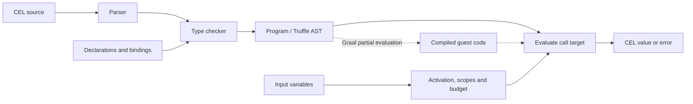
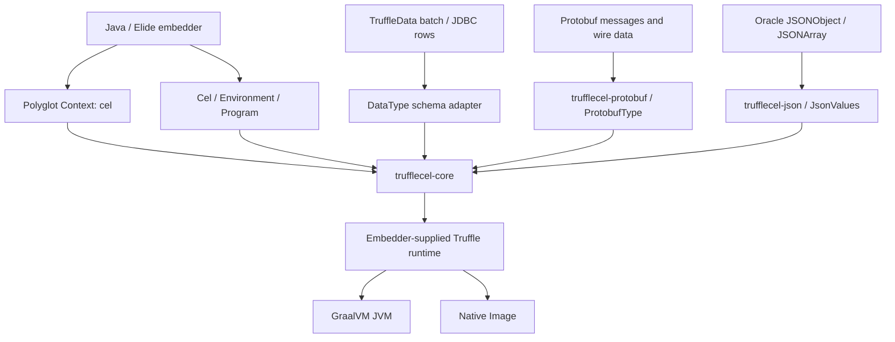

[](docs/images/trufflecel.svg)

[](https://github.com/elide-dev/trufflecel/actions/workflows/ci.yml)
[](https://codspeed.io/elide-dev/trufflecel)
[](https://github.com/elide-dev/trufflecel/releases)
[](https://www.graalvm.org/)

**CEL expressions, executed by Truffle.** TruffleCEL brings the
[Common Expression Language](https://cel.dev/) to [GraalVM Truffle](https://www.graalvm.org/latest/graalvm-as-a-platform/language-implementation-framework/)
with an independent parser, gradual type checker, and AST evaluator. Embed reusable policies,
validation rules, and filters in Java or Elide, with no CEL Java dependency.

[Get started](#choose-an-artifact) · [Architecture](#architecture) ·
[Integration guide](docs/INTEGRATION.md) · [CEL compatibility](#compatibility-and-scope) ·
[Benchmarks](https://codspeed.io/elide-dev/trufflecel)

```java
import dev.trufflecel.Cel;
import java.util.List;
import java.util.Map;

var policy = Cel.compile("user.age >= 18 && 'admin' in user.roles");
boolean allowed = policy.test(Map.of(
    "user", Map.of("age", 30, "roles", List.of("admin"))));
```

Compile once and reuse across threads. Evaluation has its own activation, comprehension
scopes and operation budget. Host collections are snapshotted, and failures carry stable
CEL error codes. Native TruffleData rows, protobuf messages and Oracle JSON objects have
explicit adapters; expressions cannot discover arbitrary Java methods.

## Architecture

Compile expressions once, then evaluate them against fresh inputs. The frontend implements
CEL parsing, name resolution, and gradual typing; each `Program` owns a reusable Truffle call
target. Evaluation state belongs to the individual call.



Truffle specializes expression execution and can compile hot guest code on a compatible
GraalVM runtime. Generic collections, libraries, input conversion, and object adapters use
explicit Truffle boundaries. The JVM and Native Image compilation gates exercise this split
and enforce allocation, AST-size, and compiler-graph budgets.



The direct Java API does not require a Polyglot context. Optional adapters keep protobuf and
Oracle JSON dependencies out of the core JAR. Native TruffleData rows retain their schema;
host collections and JSON trees are converted to bounded CEL snapshots. See the
[integration guide](docs/INTEGRATION.md) for object bindings, presence, and numeric semantics.

## Choose an artifact

| Maven coordinate | Purpose |
| --- | --- |
| `dev.elide:trufflecel-core` | Compiler, evaluator, Polyglot language and native TruffleData rows |
| `dev.elide:trufflecel-protobuf` | Optional protobuf construction, ingestion and wire decoding |
| `dev.elide:trufflecel-json` | Optional Oracle Truffle JSON input conversion |

All three are thin JARs. The optional bridges depend on the matching core version; core
does not pull in protobuf, JSON, JDBC drivers or test libraries. The runtime baseline is
**Java 25**, **Elide GraalVM `25.5.5-elide.23`**, and **TruffleData `0.1.0`**.

Artifacts are published to `maven.elide.dev`. See [Releases](https://github.com/elide-dev/trufflecel/releases)
for available versions:

```kotlin
repositories {
    mavenCentral()
    maven("https://maven.elide.dev")
    maven("https://maven.elide.dev/gvm-elide/25.5.5-elide.23")
}
dependencies {
    implementation("dev.elide:trufflecel-core:0.1.0")
    // Add trufflecel-protobuf or trufflecel-json as needed.
}
```

See [publishing](docs/PUBLISHING.md) for Maven and Bazel consumption, local staging, and
release operations.

## Embed

`Cel.compile(source)` infers free variables as `dyn`. Declare a fixed environment when
you want compile-time validation:

```java
var env = Cel.newBuilder()
    .variable("balance", CelType.INT)
    .variable("enabled", CelType.BOOL)
    .evaluationBudget(10_000)
    .build();
var program = env.compile("enabled && balance > 0");
boolean allowed = program.test(Map.of("balance", 42L, "enabled", true));
```

`Program.evaluate` returns a value; `Program.test` requires a boolean. `source`, `variables`
and `resultType` describe the compiled program. Explicit `ObjectType` and function bindings
extend the environment. The registered Polyglot language ID is `cel`.

For TruffleData, bind a `DataType` to a schema and pass immutable batch/JDBC rows directly.
For protobuf, register a `ProtobufType` and ingest messages or native `ProtoRow` values through
`input`. Binary decoding and message construction use TruffleData’s embedded codec and native
representation, with no retained Java-message sidecar. `JsonValues.from` creates
bounded, immutable CEL snapshots of Oracle `JSONObject` and `JSONArray` trees.

[Integration notes](docs/INTEGRATION.md) cover Elide's Kotlin facade, numeric and presence
semantics, native rows, well-known protobuf mappings, and adapter limitations.
[Instrumentation](docs/INSTRUMENTATION.md) covers source tags for coverage and profiling,
debugger breakpoints, local scopes, and source-aware Java embedding.

## Build and verify

Bazelisk selects the pinned Bazel version. Builds default to BuildBuddy Linux amd64 remote
execution and caching. Dependencies and toolchains are pinned. Configure
credentials outside Git, or append `--config=local` for host JVM execution.

```sh
bazel build //:trufflecel //:trufflecel-protobuf //:trufflecel-json
bazel test //...
bazel coverage //src/test/...
bazel run //tools:coverage --config=local
```

JARs are under `bazel-bin/src/main/java/dev/trufflecel/`. Gazelle owns the Java library and
test target source lists and dependency mappings. Run workspace tools locally on macOS:

```sh
bazel run //:gazelle --config=local
bazel run //tools:format --config=local
```

The reusable CI workflows check generated targets, formatting, tests, coverage, Maven
publications, and an independent JVM consumer of the publication JARs. External actions
are pinned by commit; runner hardening, limited permissions, fork-safe credentials and
serialized publishing are included. See [CI setup](docs/CI.md) and [Bazel setup](docs/BAZEL.md).

## Performance and releases

Every pull request and main update runs 14 **CodSpeed simulation** cases covering compilation,
evaluation, native data adapters, and CEL extensions. Bazel builds a Native Image executable;
the Linux CI runner measures named regions and verifies their results. Startup, fixture
creation, and warmup are excluded.

These measurements count native-AOT instructions using Truffle’s fallback interpreter.
Separate JVM and Native Image gates require guest compilation, enforce allocation and
AST-size budgets, and reject compilation blocklist violations. CodSpeed does not measure
JVM/JIT throughput. See [benchmark details](docs/BENCHMARKS.md) for the cases and methodology.

A separate suite compares **TruffleCEL and upstream cel-java 0.15.0** on scalar
arithmetic, a policy expression, and a list comprehension. It measures compilation,
guest-JIT evaluation, and interpretation on the JVM and Native Image (SVM), including
checked ASTs embedded at image build time.


<details>
<summary>Whole-process peak RSS for a fixed workload</summary>


</details>

Captured November 3, 2026 on a shared AMD EPYC 7763 CI runner. Lower is better; bars show
medians across three fresh processes, with minimum/maximum whiskers. TruffleCEL has lower
median time in **all 24 comparisons**, lower allocation in **all 24**, and lower
fixed-work peak RSS in **14 of 24**. Native guest JIT retains a substantial process-memory
cost. These are workload-specific measurements,
not a general performance guarantee.

Allocation and RSS use separate, equal-work processes: 8,192 compilations or 524,288
evaluations, plus setup. Bytes/op measures current-thread heap allocation; it excludes
compiler/background threads and native memory. RSS includes the process's entire lifetime,
including calibration, warmup, and guest compilation. Timing excludes setup and guest
compilation. Both native engines share one benchmark binary, so RSS does not represent
standalone deployment footprints. Image-build preparation embeds checked ASTs, not guest
machine code. See the [raw measurements](docs/benchmarks/comparison.json),
[measurement run](https://github.com/elide-dev/trufflecel/actions/runs/41741898254), and
[methodology and reproduction commands](docs/BENCHMARKS.md#comparison-with-upstream-cel-java).

The [first allocation snapshot](docs/benchmarks/comparison-allocation-baseline-v3.json) is
retained alongside the [earlier time-bounded RSS snapshot](docs/benchmarks/comparison-throughput-rss-v2.json), which
used different operation counts for each engine; its RSS is not directly comparable with
this fixed-work measurement. The [original timing baseline](docs/benchmarks/comparison-baseline.json),
[earlier optimized timing snapshot](docs/benchmarks/comparison-optimized-v1.json), and
[CodSpeed optimization history](docs/BENCHMARKS.md#finding-instruction-hotspots) are retained.

CI preserves fresh JSON and SVG results in its `cel-comparison` artifact.

After successful main checks, Release Please opens version/changelog PRs from conventional
commits. Merging a release PR creates a version tag. The Maven publisher uses that exact tag to
publish JARs, sources, POMs, and checksums to `maven.elide.dev`; it requires the R2 credentials
described in [CI setup](docs/CI.md). Existing versions are immutable.

## Compatibility and scope

The conformance suite runs **2,587 cases across 20 upstream core CEL suites and six extension
suites**, with no per-case skips, pinned to cel-spec revision
[`21ec6f4`](https://github.com/cel-expr/cel-spec/tree/21ec6f4e52e8d694687ff9ed7408d3eccbb955d7).
It checks values, errors, namespaces, declarations, macros and inferred types.
[Corpus provenance](third_party/cel-spec/README.md).

CI requires **98% production line coverage and 90% branch coverage**, including optional
adapters. Additional tests cover resource limits, concurrency, interop, published TruffleData
artifacts and Maven consumption. The core corpus uses an independent test-only protobuf
fixture; adapter tests separately exercise the published protobuf implementation.

Optional values, two-variable macros, and extended string/list/math/network libraries are
covered by all cases in their pinned upstream suites. See [extension support](docs/EXTENSIONS.md)
for APIs, semantics and limits. This does not certify every CEL extension or future revision:
binding/block/set/encoder extensions, canonical protobuf AST serialization, and a proto2
extension registry are not yet provided. Elide Native Image embedding and production size,
allocation, and JIT performance budgets still need qualification.

## Reference shelf

| Reference | What it covers |
| --- | --- |
| [CEL specification](https://github.com/cel-expr/cel-spec) | Upstream language specification, schemas, and conformance tests |
| [CEL language definition](https://github.com/cel-expr/cel-spec/blob/master/doc/langdef.md) | Syntax, types, evaluation, and standard functions |
| [Pinned conformance corpus](third_party/cel-spec/README.md) | Exact upstream revision, selected suites, and reproducible import |
| [TruffleCEL extensions](docs/EXTENSIONS.md) | Supported optional, string, list, math, and network APIs |
| [TruffleData](https://github.com/elide-dev/truffledata) | Native Truffle data types, rows, and protobuf integration |
| [Bazel](docs/BAZEL.md) / [CI](docs/CI.md) | Toolchains, BuildBuddy, generated targets, and quality gates |
| [Benchmark methodology](docs/BENCHMARKS.md) | Paired cel-java timings, SVG results, CodSpeed simulation, and guest-JIT qualification |
| [Publishing](docs/PUBLISHING.md) | Maven consumption, release automation, and artifact verification |
