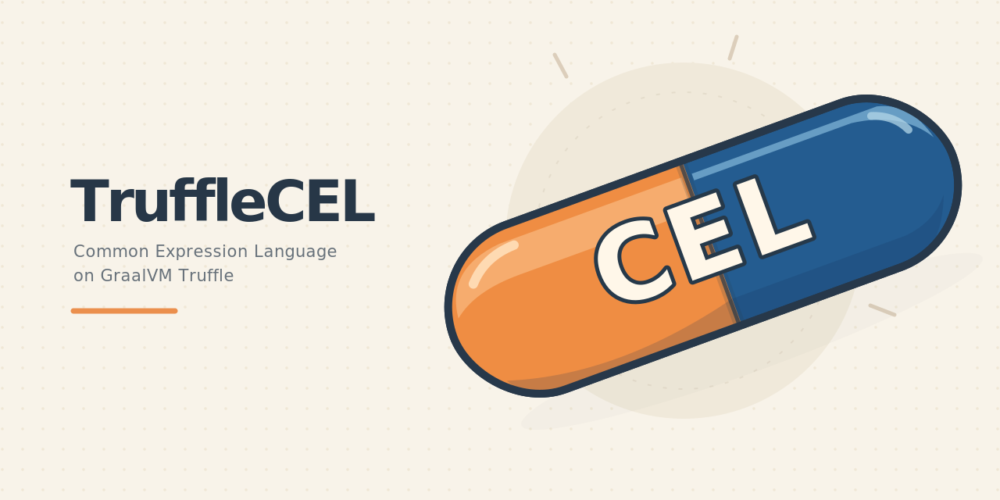
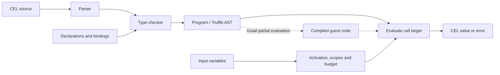
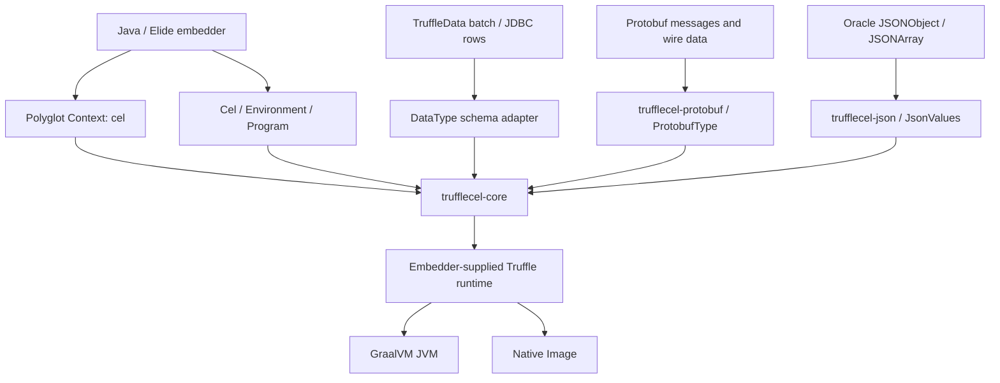
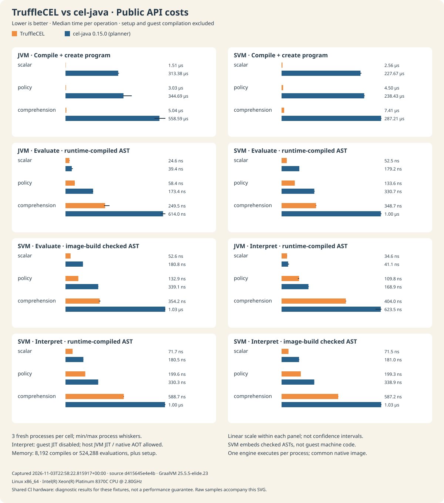
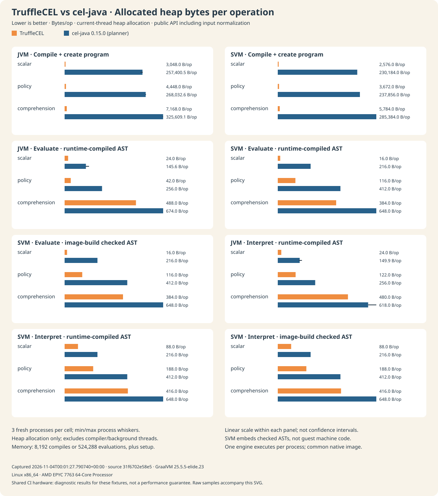
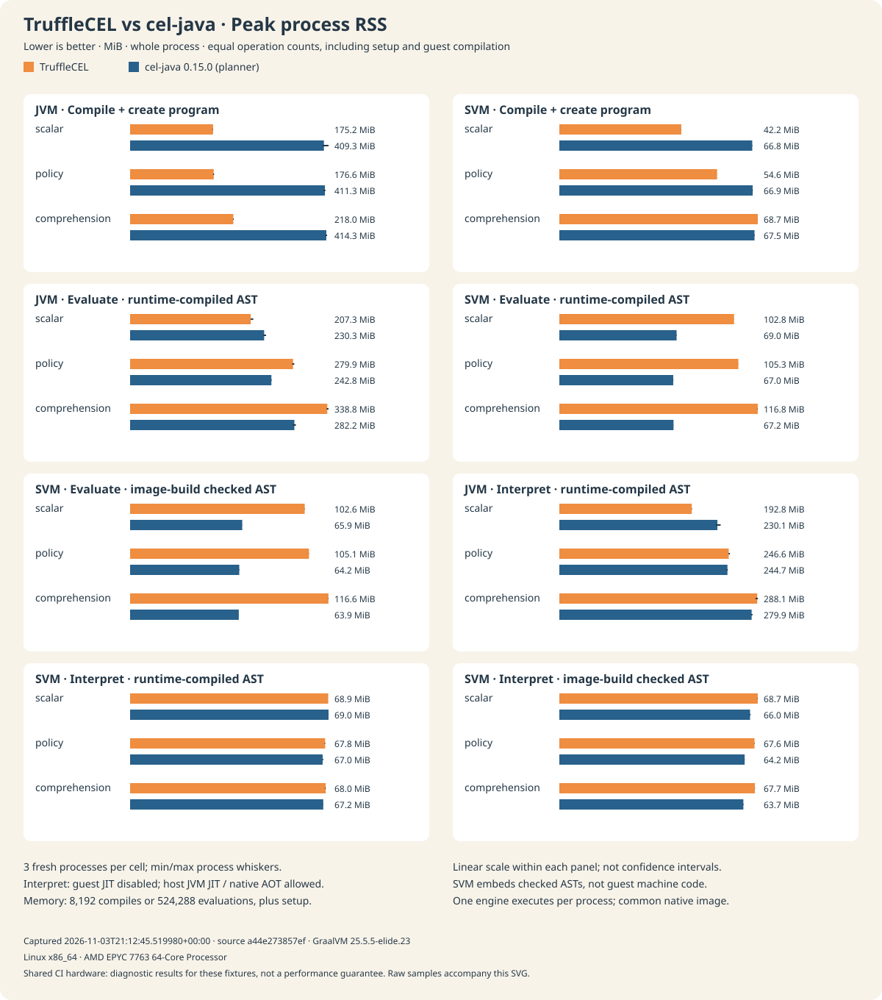

[](docs/images/trufflecel.svg)

[](https://github.com/elide-dev/trufflecel/actions/workflows/ci.yml)
[](https://codecov.io/gh/elide-dev/trufflecel)
[](https://codspeed.io/elide-dev/trufflecel)
[](https://github.com/elide-dev/trufflecel/releases)
[](https://scorecard.dev/viewer/?uri=github.com/elide-dev/trufflecel)
[](https://www.graalvm.org/)

**CEL expressions, executed by Truffle.** TruffleCEL brings the
[Common Expression Language](https://cel.dev/) to [GraalVM Truffle](https://www.graalvm.org/latest/graalvm-as-a-platform/language-implementation-framework/)
with an independent parser, gradual type checker, and AST evaluator. Embed reusable policies,
validation rules, and filters in Java or Elide, with no CEL Java dependency.

[Get started](#choose-an-artifact) · [Architecture](#architecture) ·
[Integration guide](docs/INTEGRATION.md) · [CEL compatibility](#compatibility-and-scope) ·
[Benchmarks](https://codspeed.io/elide-dev/trufflecel)

```java
import dev.trufflecel.Cel;
import java.util.List;
import java.util.Map;

var policy = Cel.compile("user.age >= 18 && 'admin' in user.roles");
boolean allowed = policy.test(Map.of(
    "user", Map.of("age", 30, "roles", List.of("admin"))));
```

Compile once and reuse across threads. Evaluation has its own activation, comprehension
scopes and operation budget. Host collections are snapshotted, and failures carry stable
CEL error codes. Native TruffleData rows, protobuf messages and Oracle JSON objects have
explicit adapters; expressions cannot discover arbitrary Java methods.

## Architecture

Compile expressions once, then evaluate them against fresh inputs. The frontend implements
CEL parsing, name resolution, and gradual typing; each `Program` owns a reusable Truffle call
target. Evaluation state belongs to the individual call.



Truffle specializes expression execution and can compile hot guest code on a compatible
GraalVM runtime. Generic collections, libraries, input conversion, and object adapters use
explicit Truffle boundaries. The JVM and Native Image compilation gates exercise this split
and enforce allocation, AST-size, and compiler-graph budgets.



The direct Java API does not require a Polyglot context. Optional adapters keep protobuf and
Oracle JSON dependencies out of the core JAR. Native TruffleData rows retain their schema;
host collections and JSON trees are converted to bounded CEL snapshots. See the
[integration guide](docs/INTEGRATION.md) for object bindings, presence, and numeric semantics.

## Choose an artifact

| Maven coordinate | Purpose |
| --- | --- |
| `dev.elide:trufflecel-core` | Compiler, evaluator, Polyglot language and native TruffleData rows |
| `dev.elide:trufflecel-protobuf` | Optional protobuf construction, ingestion, wire decoding and canonical CEL AST interchange |
| `dev.elide:trufflecel-json` | Optional Oracle Truffle JSON input conversion |

All three are thin JARs. The optional bridges depend on the matching core version; core
does not pull in protobuf, JSON, JDBC drivers or test libraries. The current source tree targets
**Java 25**, **Elide GraalVM `25.5.5-elide.24`**, and **TruffleData `0.6.0`**.

Artifacts are published to `maven.elide.dev`. See [Releases](https://github.com/elide-dev/trufflecel/releases)
for available versions. The example below uses released TruffleCEL `0.4.1`, whose POM pins
TruffleData `0.6.0`:

```kotlin
repositories {
    mavenCentral()
    maven("https://maven.elide.dev")
    maven("https://maven.elide.dev/gvm-elide/25.5.5-elide.24")
}
dependencies {
    implementation("dev.elide:trufflecel-core:0.4.1")
    // Add trufflecel-protobuf or trufflecel-json as needed.
}
```

See [publishing](docs/PUBLISHING.md) for Maven and Bazel consumption, local staging, and
release operations.

## Embed

`Cel.compile(source)` infers free variables as `dyn`. Declare a fixed environment when
you want compile-time validation:

```java
var env = Cel.newBuilder()
    .variable("balance", CelType.INT)
    .variable("enabled", CelType.BOOL)
    .evaluationBudget(10_000)
    .build();
var program = env.compile("enabled && balance > 0");
boolean allowed = program.test(Map.of("balance", 42L, "enabled", true));
```

`Program.evaluate` returns a value; `Program.test` requires a boolean. `source`, `variables`
and `resultType` describe the compiled program. Explicit `ObjectType` and function bindings
extend the environment. The registered Polyglot language ID is `cel`.

For TruffleData, bind a `DataType` to a schema and pass immutable batch/JDBC rows directly.
For protobuf, register a `ProtobufType` and ingest messages or native `ProtoRow` values through
`input`. Binary decoding and message construction use TruffleData’s embedded codec and native
representation, with no retained Java-message sidecar. `JsonValues.from` creates
bounded, immutable CEL snapshots of Oracle `JSONObject` and `JSONArray` trees.

[Integration notes](docs/INTEGRATION.md) cover Elide's Kotlin facade, numeric and presence
semantics, native rows, well-known protobuf mappings, and adapter limitations.
[Instrumentation](docs/INSTRUMENTATION.md) covers source tags for coverage and profiling,
debugger breakpoints, local scopes, and source-aware Java embedding.

## Build and verify

Bazelisk selects the pinned Bazel version. Builds default to BuildBuddy Linux amd64 remote
execution and caching. Dependencies and toolchains are pinned. Configure
credentials outside Git, or append `--config=local` for host JVM execution.

```sh
bazel build //:trufflecel //:trufflecel-protobuf //:trufflecel-json
bazel test //...
bazel coverage //src/test/...
bazel run //tools:coverage --config=local
```

JARs are under `bazel-bin/src/main/java/dev/trufflecel/`. Gazelle owns the Java library and
test target source lists and dependency mappings. Run workspace tools locally on macOS:

```sh
bazel run //:gazelle --config=local
bazel run //tools:format --config=local
```

The reusable CI workflows check generated targets, formatting, tests, coverage, Maven
publications, and an independent JVM consumer of the publication JARs. External actions
are pinned by commit; runner hardening, limited permissions, fork-safe credentials and
serialized publishing are included. See [CI setup](docs/CI.md) and [Bazel setup](docs/BAZEL.md).

## Performance and releases

Every pull request and main update runs 14 **CodSpeed simulation** cases covering compilation,
evaluation, native data adapters, and CEL extensions. Bazel builds a Native Image executable;
the Linux CI runner measures named regions and verifies their results. Startup, fixture
creation, and warmup are excluded.

These measurements count native-AOT instructions using Truffle’s fallback interpreter.
Separate JVM and Native Image gates require guest compilation, enforce allocation and
AST-size budgets, and reject compilation blocklist violations. CodSpeed does not measure
JVM/JIT throughput. See [benchmark details](docs/BENCHMARKS.md) for the cases and methodology.

For cross-engine comparisons, start with **interpreter-to-interpreter** results under
the same host runtime. Guest-JIT throughput answers a separate question about hot,
reused expressions: include preparation and warmup when evaluating that tradeoff.
The [representative suite](docs/BENCHMARKS.md#representative-comparisons) adds protobuf
policies, wide activations, optimizer-enabled cel-java, JMH, and fresh-process evaluation
curves. Compilation includes this library's own parser and checker; it is not Truffle
guest compilation. Corpus coverage and microbenchmark speedups do not establish a
general replacement for another CEL engine.

<details>
<summary>Historical three-expression comparison (TruffleCEL 0.2.0)</summary>

The earlier suite compares **TruffleCEL and upstream cel-java 0.15.0** on scalar
arithmetic, a policy expression, and a list comprehension. It measures compilation,
guest-JIT evaluation, and interpretation on the JVM and Native Image (SVM), including
checked ASTs embedded at image build time.





<details>
<summary>Whole-process peak RSS for a fixed workload</summary>



</details>

Measured **TruffleCEL 0.2.0**, captured **2026-11-04 (UTC)** on a shared
AMD EPYC 7763 64-Core Processor CI runner. Lower is better; bars show medians across
three fresh processes, with minimum/maximum whiskers. TruffleCEL has lower median time
in **24 of 24 comparisons**, lower allocation in **24 of 24**, and lower
peak RSS for fixed workloads in **16 of 24**. Native guest JIT still requires
substantial process memory. These results cover the tested workloads and runtime settings.

Allocation and RSS use separate, equal-work processes: 8,192 compilations or 524,288
evaluations, plus setup. Bytes/op measures current-thread heap allocation; it excludes
compiler/background threads and native memory. RSS includes the process's entire lifetime,
including calibration, warmup, and guest compilation. Timing excludes setup and guest
compilation. Both native engines share one benchmark binary, so RSS does not represent
standalone deployment footprints. Image-build preparation embeds checked ASTs, not guest
machine code. See the [raw measurements](docs/benchmarks/comparison.json),
[measurement run](https://github.com/elide-dev/trufflecel/actions/runs/41754803857), and
[methodology and reproduction commands](docs/BENCHMARKS.md#comparison-with-upstream-cel-java).

The [first allocation snapshot](docs/benchmarks/comparison-allocation-baseline-v3.json) is
retained alongside the [earlier time-bounded RSS snapshot](docs/benchmarks/comparison-throughput-rss-v2.json), which
used different operation counts for each engine; its RSS is not directly comparable with
this fixed-work measurement. The [original timing baseline](docs/benchmarks/comparison-baseline.json),
[earlier optimized timing snapshot](docs/benchmarks/comparison-optimized-v1.json), and
[CodSpeed optimization history](docs/BENCHMARKS.md#finding-instruction-hotspots) are retained.

CI preserves fresh JSON and SVG results in its `cel-comparison` artifact.

These microbenchmarks use small activations, cel-java without its optional AST optimizers,
and a 500 ms warmup on shared hardware. Guest compilation is forced before timing.
They do not measure cold-start costs or representative protobuf evaluation.
</details>

After successful main checks, Release Please opens version/changelog PRs from conventional
commits. Merging a release PR creates a version tag. The Maven publisher uses that exact tag to
publish JARs, sources, POMs, and checksums to `maven.elide.dev`; it requires the R2 credentials
described in [CI setup](docs/CI.md). Existing versions are immutable.

## Compatibility and scope

The conformance suite runs **all 2,771 cases across the 32 files in the upstream CEL corpus**, with no
suite exclusions or per-case skips, pinned to cel-spec revision
[`21ec6f4`](https://github.com/cel-expr/cel-spec/tree/21ec6f4e52e8d694687ff9ed7408d3eccbb955d7).
It checks values, errors, namespaces, declarations, macros and inferred types.
[Corpus provenance](third_party/cel-spec/README.md).

CI requires **99.8% production line coverage and 99.8% branch coverage**, including optional
adapters. Additional tests cover resource limits, concurrency, interop, published TruffleData
artifacts and Maven consumption. Every corpus case runs with both an independent test-only
protobuf fixture and the shipped `ProtobufType` adapter backed by TruffleData, through both
the direct frontend and canonical AST interchange (11,084 executions of 2,771 cases).
The production-adapter path uses unmodified upstream proto2/proto3 schemas and protobuf-java
fixture construction. This is evidence of compatibility with the pinned corpus, not exhaustive
specification compliance. Corpus error cases assert an evaluation failure, not its category
or diagnostic text; separate negative and differential tests check rejection phases and
selected error categories. Custom functions, limits, concurrency, and unknown propagation
have separate regression tests.
See the [coverage audit](docs/COVERAGE.md) for measured totals and remaining defensive paths.

The table describes the current `main` branch against the pinned corpus, not every CEL
extension or future specification revision. ✅ means implemented; the scope column identifies
validation evidence and execution limits.

| Capability | Status | Scope and limitations |
| --- | --- | --- |
| Independent parser, type checker, and evaluator | ✅ Implemented | No CEL Java frontend or interpreter dependency; core syntax, types, operators, namespaces, and standard functions pass the pinned suites. |
| Complete pinned conformance corpus | ✅ Passing | All 2,771 cases across 32 files; no suite exclusions or per-case skips. |
| Macros and optional values | ✅ Implemented | Standard macros, two-variable comprehensions, optional selection/indexing, and optional aggregate entries. |
| String, list, math, and network extensions | ✅ Implemented | All cases in their pinned suites; see [supported APIs and limits](docs/EXTENSIONS.md). |
| Local bindings and set operations | ✅ Implemented | `cel.bind`, `sets.contains`, `sets.equivalent`, and `sets.intersects`. |
| Lazy blocks | ✅ Implemented | `cel.block`, `cel.index`, and `cel.iterVar`; cached values/errors and isolated lexical scopes. |
| Block optimization | ✅ Implemented | Slot reads resolve to their initializer nodes; JVM guest-compilation and allocation gates cover the compiled path. Source-backed tooling retains observable boundary evaluation. |
| Base64 encoding/decoding | ✅ Implemented | Standard alphabet, padded or unpadded decoding, and CR/LF handling. |
| URL-safe Base64 and structured encoders | ✅ Implemented | `base64.encodeUrl`/`decodeUrl`, `json.encode`/`parse`, and `yaml.encode`/`parse`, including typed optional parsing and bounded data traversal. |
| Protobuf messages and well-known types | ✅ Implemented | Proto2/proto3 fields, construction, presence, native wire decoding, and registered `Any` payloads through [TruffleData](docs/INTEGRATION.md). |
| Proto2 extensions | ✅ Implemented | `proto.hasExt` and `proto.getExt`; descriptors must be registered explicitly. |
| Protobuf Editions and MessageSet | ✅ Implemented | Resolved edition presence, packing and enum features feed native plans; explicitly registered MessageSet payloads and unknown payloads round-trip through native storage. |
| Unknown values | ✅ Implemented | Propagation, error precedence and short-circuiting have regression coverage, including AST and RPC paths. Upstream's empty `unknowns` file provides no additional conformance evidence. |
| Canonical protobuf AST interchange | ✅ Implemented | `CanonicalAst` exports/imports `ParsedExpr` and `CheckedExpr`; all pinned cases also run through interchange, with cross-engine wire tests. |
| CEL conformance RPC service | ✅ Implemented | Standalone gRPC Parse/Check/Eval service, with explicit descriptor registration, bounded requests and loopback transport tests; see [interchange and RPC](docs/INTERCHANGE.md). |
| JVM embedding and Truffle tooling | ✅ Implemented | Thin JARs, Polyglot integration, node instrumentation, profiling/coverage tags, and debugger scopes. |
| Native Image guest compilation | ✅ Tested | Native JIT/blocklist checks and representative compiled-operation tests run in CI. |

Resource limits intentionally bound expression size/depth, evaluation work, and collection or
string expansion. See [extension support](docs/EXTENSIONS.md), [integration](docs/INTEGRATION.md),
and [benchmark methodology](docs/BENCHMARKS.md) for the detailed contracts.

## Reference shelf

| Reference | What it covers |
| --- | --- |
| [CEL specification](https://github.com/cel-expr/cel-spec) | Upstream language specification, schemas, and conformance tests |
| [CEL language definition](https://github.com/cel-expr/cel-spec/blob/master/doc/langdef.md) | Syntax, types, evaluation, and standard functions |
| [Pinned conformance corpus](third_party/cel-spec/README.md) | Exact upstream revision, complete corpus, and reproducible import |
| [TruffleCEL extensions](docs/EXTENSIONS.md) | Supported optional, string, list, math, and network APIs |
| [TruffleData](https://github.com/elide-dev/truffledata) | Native Truffle data types, rows, and protobuf integration |
| [Bazel](docs/BAZEL.md) / [CI](docs/CI.md) | Toolchains, BuildBuddy, generated targets, and quality gates |
| [Benchmark methodology](docs/BENCHMARKS.md) | Paired cel-java timings, SVG results, CodSpeed simulation, and guest-JIT qualification |
| [Publishing](docs/PUBLISHING.md) | Maven consumption, release automation, and artifact verification |

## Community and licensing

Contributions are open to everyone; see [Contributing](CONTRIBUTING.md),
[Governance](GOVERNANCE.md), and our [Code of Conduct](CODE_OF_CONDUCT.md).
For help, see [Support](SUPPORT.md). Report vulnerabilities privately through
our [Security Policy](SECURITY.md).

TruffleCEL is dual-licensed under [MIT](LICENSE-MIT) or
[Apache-2.0](LICENSE-APACHE), at your option (`MIT OR Apache-2.0`).
See [LICENSE](LICENSE) and [NOTICE](NOTICE) for scope and third-party attribution.

Security automation, dependency update coverage and the OpenSSF readiness roadmap are
documented in [Maintenance](docs/MAINTENANCE.md) and the [threat model](docs/THREAT_MODEL.md).
