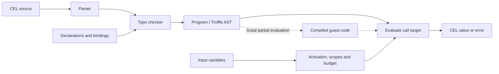
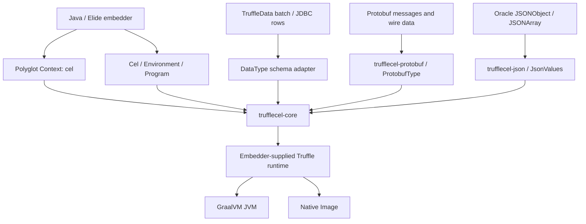

# TruffleCEL architecture

Compile expressions once, then evaluate them against fresh inputs. The frontend implements
CEL parsing, name resolution, and gradual typing; each `Program` owns a reusable Truffle call
target. Evaluation state belongs to the individual call.

Truffle specializes expression execution and can compile hot guest code on a compatible
GraalVM runtime. Generic collections, libraries, input conversion, and object adapters use
explicit Truffle boundaries. The JVM and Native Image compilation gates exercise this split
and enforce allocation, AST-size, and compiler-graph budgets.

The direct Java API does not require a Polyglot context. Optional adapters keep protobuf and
Oracle JSON dependencies out of the core JAR. Native TruffleData rows retain their schema;
host collections and JSON trees are converted to bounded CEL snapshots. See the
[integration guide](INTEGRATION.md) for object bindings, presence, and numeric semantics.
