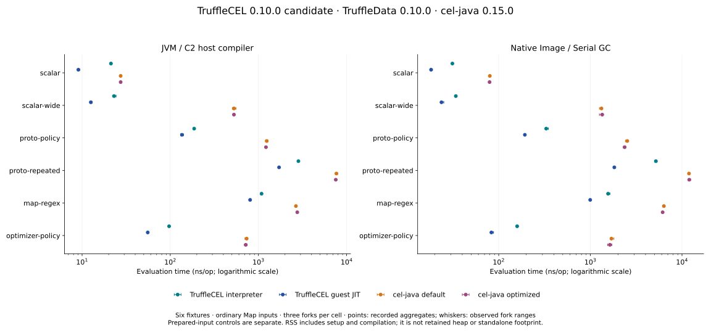

# TruffleCEL 0.10.0 final-dependency qualification

This report measures the final TruffleData 0.10.0 dependency with the completed
TruffleCEL 0.10.0 production code. Historical reports retain their original data.
This is a fresh cross-engine comparison, not a controlled before/after experiment
attributing changes to TruffleData alone.

The ordinary-map six-fixture matrix records lower TruffleCEL evaluation time in
all 24 runtime/mode/fixture comparisons against the faster cel-java planner mode.
Allocation is lower in 23 with one tie. Process memory remains a gap:

| Metric | Lower TruffleCEL point estimate | Equal | Higher | Overlapping fork ranges |
| --- | ---: | ---: | ---: | ---: |
| Evaluation time | 24 | 0 | 0 | 0 |
| Current-thread allocation | 23 | 1 | 0 | 1 |
| Current RSS | 9 | 0 | 15 | 0 |
| Lifetime peak RSS | 10 | 0 | 14 | 3 |

Counts use the lower of cel-java's default/optimized values separately for each
metric. They are descriptive aggregates and observed ranges, not significance
tests, guaranteed speedups or rankings against every embedding API.

[All values and ranges](summary.json) and [complete tables](tables.md) retain every
cell. Native guest-JIT current RSS is 257.48 MiB for protobuf policy, 190.16 MiB for
materialized repeated lists and 245.43 MiB for maps/regexes, versus the lower
cel-java mode's 119.27, 66.91 and 92.56 MiB. No cell has more than 10% first-two versus
last-two timing-window drift in the recorded diagnostic; that does not establish
an exclusive host or statistical significance.



[Allocation chart](../../images/release-0.10.0/evaluation-allocation.svg) ·
[Current RSS chart](../../images/release-0.10.0/evaluation-rss.svg)

The [prepared-input controls](prepared-inputs.md) show why input representation
matters. Reusing Guava ImmutableMaps reduces cel-java scalar-wide time from
508.76–526.82 to 25.33–26.01 ns/op on JVM and 1,305.87–1,364.54 to 63.46–63.93 ns/op
on native, across the two planner modes. Allocation falls from 2,936 to 72 B/op
on JVM and 3,504 to 120 B/op on native. TruffleCEL's JVM scalar-wide interpreter
uses 120 B/op, so the ordinary-map allocation count does not establish a win over
that 72 B/op prepared comparator. All 69 bindings remain present and caller-side
preparation is excluded. Complete fork observations are in
[prepared-inputs.json](prepared-inputs.json).

Ingestion still has allocation gaps. Ordinary CEL wire decode allocates 5,152 B/op
on JVM and 4,628 B/op on native, versus stock protobuf's 4,300 and 4,076 B/op.
With a 64 KiB unknown payload, native CEL decode allocates 135,828 B/op versus
70,052 B/op for stock parsing; decode-plus-evaluate allocates 205,886 versus
77,530 B/op. Direct-plan allocation increases by 131,192 B/op on JVM and 131,200
on native when the unknown payload is added. The remaining staging request
[TruffleData #38](https://github.com/elide-dev/truffledata/issues/38) is still open.
Bound generated-message snapshots are a separate path: ordinary JVM allocation
is 3,772 versus CEL snapshot's 5,666 B/op, while native is 5,408 versus 5,062 B/op.
The complete [ingestion table](ingestion.md) retains all stages and forks; no
throughput or retained-memory improvement is inferred from these counts.

The separate [adoption-main CI comparison](ci/tables.md) on an Intel Xeon Platinum
8573C worker records 24/24 lower time and allocation medians, with 12/24 lower peak
RSS medians. One timing comparison has overlapping process ranges. Its three
expressions, compilation/image-AST stages, host and fixed-work memory protocol
differ from the six-fixture report. [CI time](../../images/release-0.10.0/ci-comparison.svg),
[allocation](../../images/release-0.10.0/ci-allocations.svg) and
[peak RSS](../../images/release-0.10.0/ci-peak-rss.svg) charts preserve that separate scope.

## Source and runtime identities

- Measured source: `cf0d51d85cd6041a93e2aed6178f88a0c3cdaa73`.
- Adoption main: `41d54e4ca797b79304f21302105dae6597faf001` (#66), with an identical tree.
- Dependencies: TruffleData 0.10.0, Elide GraalVM 25.5.5-elide.27, cel-java 0.15.0,
  JMH 1.37. RE2/J remains optional for consumers; these comparison artifacts include
  the default compatibility fallback and scoped TruffleRegex RE2 acceleration.
- [source.json](source.json) records hashes of the production, dependency, build
  and harness inputs. [source.patch.gz](source.patch.gz) reconstructs those changes
  from main `92a0944c18f64e65e46b06e9077fdb19ad6a3f9d`.
- Six-fixture measurements execute serially on `unclemax`, a Linux x86-64 AMD Ryzen
  Threadripper PRO 9965WX host, using CPUs 2–9. The shared measurement lock prevents
  overlapping TruffleCEL benchmark jobs. The host is shared, not exclusively
  reserved; no governor, NUMA, THP or other global host settings were changed.
- The preserved GraalVM archive SHA-256 matches MODULE.bazel. Phase metadata records
  JVM/runtime-file and artifact hashes, effective options, CPU/kernel/governor data,
  observed load, exact commands and source identities. Observed one-minute load
  ranges from 0.08 to 2.03 across the six evaluation/control phases on this
  48-thread host; this is an observation, not exclusive-host isolation.

## Evaluation protocol

The completed separate Linux run contains 288 primary evaluation processes, 96
prepared-input control processes and 18 ingestion processes. All requested cells
complete; per-fork regex-backend checks and all 150 source hashes pass verification.
The measured Java executable, runtime release metadata, modules and libjvm hashes
also match the pinned GraalVM archive members.

Six fixtures cover scalar, scalar-wide, protobuf policy, repeated protobuf lists,
map/regex and optimizer policy. Each checks four input variants. Scalar has one
binding; all others retain all 69 bindings. Repeated-list evaluation materializes
and checks the full 77–80 element result from 128 input elements. Input creation
and protobuf ingestion happen before evaluation timing and allocation intervals.

The ordinary-map comparison runs TruffleCEL interpreter and guest JIT against
cel-java default and constant-folding/CSE planners. JVM timing uses C2 as the host
compiler (`-XX:-UseJVMCICompiler`) while retaining Truffle guest compilation. Every
TruffleCEL process checks its compilation mode; guest JIT requires a valid last-tier
target. Compilation failures and compiler performance warnings fail qualification.
Actual regex backend and accelerated node counts are checked outside timed intervals
in every relevant fork. No failed case is silently skipped.

JVM timing uses three JMH forks per cell, each with five one-second warmups and five
one-second measurements. Aggregates are the mean of three fork means. Native timing
uses three fresh processes per cell, with five warmup and seven measurement windows;
aggregates are medians of three process medians. JVM and native use 512 MiB initial
and maximum heaps; native uses Serial GC. Timing has no allocation profiler attached.

Memory runs use separate fresh processes: five warmup and seven measured batches
of 65,536 evaluations. A calibrated per-thread allocation counter excludes compiler
and background threads. The parent captures current RSS from `smaps_rollup.Rss` and
lifetime peak RSS from `status.VmHWM` while the program and inputs remain live.
Guest JIT has 2,000 additional preparation calls and forced compilation. RSS includes
setup, compilation, calibration and sampled work at an uncontrolled GC position;
it is not retained heap or equal total work from process launch. The combined
comparison artifacts are not standalone deployment-footprint measurements.

The [prepared-input controls](prepared-inputs.md) separately compare ordinary maps
and caller-prepared Guava ImmutableMaps for scalar-wide and protobuf policy, with
both cel-java planners and runtimes. Both forms use the same captured-array lookup,
preserve all bindings and values, and exclude caller preparation. These controls
must accompany ordinary-map results because cel-java copies ordinary input maps.

The [ingestion allocation table](ingestion.md) covers ordinary protobuf messages,
a 64 KiB unknown payload, and MessageSet normalization. Each runtime/fixture has
three fresh processes and seven fixed-work windows per operation. Correctness and
an escaping allocation-counter calibration are required. These are allocation
measurements, not ingestion throughput or memory-retention claims. The historical
MessageSet harness retains its normalization path; it does not exercise every newly
available bound-ingestion API.

## Release qualification

[Qualification receipts](qualification.json) link full conformance, ownership,
concurrency, packaged consumers, mandatory allocation/guest-JIT gates and exact
0.10.0 Maven staging. All 75 qualification targets and 72 staging targets pass.
Full-source coverage is 8,267/8,283 lines (99.81%) and 7,557/7,572 branches (99.80%);
99.8% floors are unchanged, with no exclusions. CodSpeed reports all 21 benchmarks
unchanged against pre-adoption main `92a0944`. The dependency gate verifies published
stable TruffleData 0.10.0 and all four adopted Maven coordinates.

The separate three-expression CI report covers compilation, interpreter and guest
JIT on JVM/native, including image-prepared ASTs. It uses a different CI host and
memory protocol; its observations are not pooled with the six-fixture results.

Existing startup/payback, retained-heap and broader scaling research remains scoped
to its original reports and dependencies. This qualification does not establish
universal optimality against cel-java or close every memory/ingestion gap.

## Reproduce and preserve

[raw.tar.gz](raw.tar.gz) preserves all raw windows, JMH results/logs, process-memory
snapshots, metadata, run script and driver copies; it omits large build artifacts,
whose hashes remain recorded. [SHA256SUMS](SHA256SUMS) covers retained evidence.
[Staged publication hashes](staged-publications.sha256) identify the four exact-version
modules' binary/source JARs and POMs. Existing measurements were not rewritten.

Build the measured artifacts using the pinned Bazel/GraalVM toolchains:

```sh
bazel build //benchmarks/representative:jmh_deploy.jar \
  //benchmarks/representative:evaluation_memory_deploy.jar \
  //benchmarks/representative:svm //benchmarks/representative:evaluation_memory_svm \
  //benchmarks/representative:ingestion_profile_deploy.jar \
  //benchmarks/representative:ingestion_allocation_svm --remote_download_toplevel
```

Use the preserved run script on a quiet Linux host with fresh output directories.
To validate and regenerate this report from its retained measurements:

```sh
report=docs/benchmarks/release-0.10.0-20261109
mkdir /tmp/trufflecel-010-report-raw
tar -xzf "$report/raw.tar.gz" -C /tmp/trufflecel-010-report-raw
python3 "$report/verify.py" /tmp/trufflecel-010-report-raw
python3 "$report/summarize_evaluation.py" \
  --raw /tmp/trufflecel-010-report-raw/evaluation --output "$report"
python3 "$report/summarize_controls.py" /tmp/trufflecel-010-report-raw "$report"
# In an isolated Python environment with chart-requirements.txt installed:
python3 "$report/render.py" "$report/summary.json" docs/images/release-0.10.0
```
