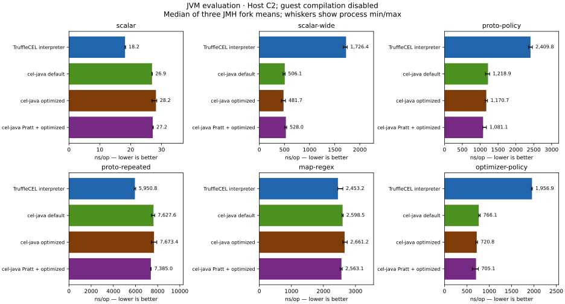
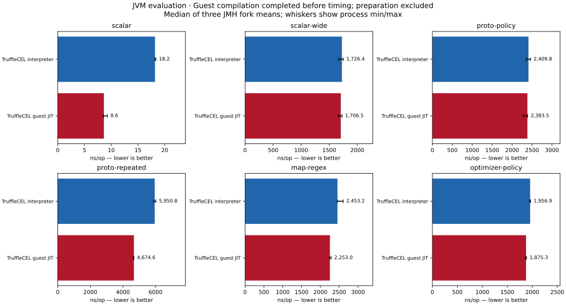
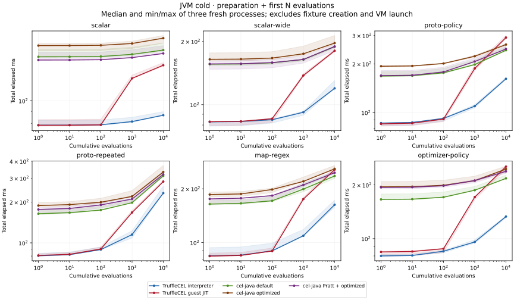
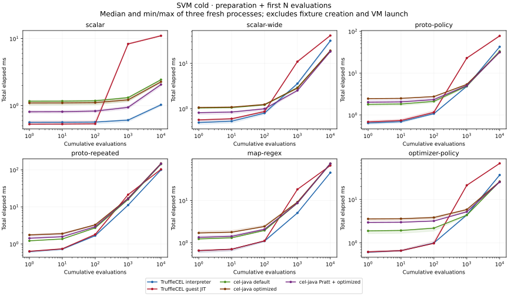
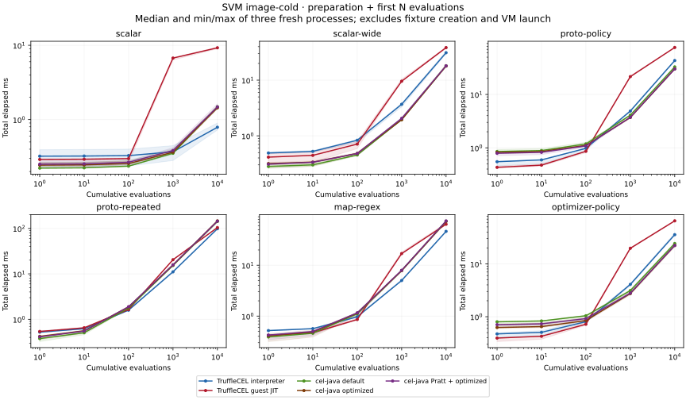

# Representative CEL measurements, November 5, 2026

The broader workloads produce mixed results. TruffleCEL's small scalar and repeated-list
results do not generalize to wide activations or protobuf policies. Guest compilation
helps some hot expressions, but does little for work outside the guest target.

## JVM evaluation

Median of three JMH process means, in ns/op; lower is better. Every process uses C2 for
host compilation. TruffleCEL guest compilation is disabled in the interpreter column
and completed before timing in the guest-JIT column. Preparation and ingestion are excluded.

| Workload | TruffleCEL interpreter | cel-java default | cel-java folding/CSE | TruffleCEL guest JIT |
| --- | ---: | ---: | ---: | ---: |
| Scalar, one binding | 18.2 | 26.9 | 28.2 | 8.6 |
| Same scalar, full activation | 1,726 | 506 | 482 | 1,707 |
| Protobuf policy | 2,410 | 1,219 | 1,171 | 2,383 |
| Protobuf repeated list | 5,951 | 7,628 | 7,673 | 4,675 |
| Maps/regex | 2,453 | 2,598 | 2,661 | 2,253 |
| Policy with optimizer opportunities | 1,957 | 766 | 721 | 1,875 |

The full activation has 69 bindings: 64 unused scalar variables plus `x`, `email`, a
65-entry map, a 128-element list, and a protobuf request. It is identical across engines.
The scalar control passes only `x`. The increase between those two rows is evidence that
activation handling deserves attention; it is not an isolated measurement of normalization.
`Program.arguments` currently visits and normalizes the full map when it contains structured
values. Profiling and an ownership-preserving design should precede changing that behavior.





The Pratt-plus-optimizer configuration is also measured; all five configurations and
process ranges are in [the complete tables](tables.md) and [derived summaries](summary.json).
The modest map/regex difference should not be treated as a broad performance advantage.

## Compilation and optimization

The stage measurements support the fixed-overhead explanation for the original tiny-source
compilation ratio. With cel-java's ANTLR frontend, checking `true` costs about **106.8 µs**
and checking `x * 2 + 1` costs **106.9 µs**. Parse time for those sources is about 1.07 and
2.41 µs. The Pratt parser reduces parsing to about 0.075 and 0.160 µs, while checking remains
about 103–106 µs. Faster parsing barely changes the complete tiny-expression compilation cost.
This comparison measures TruffleCEL's own frontend, not a benefit supplied by Truffle JIT.

Optimizers have a cost and a workload-dependent benefit. For `optimizer-policy`, cel-java's
complete compile/optimize/plan path rises from about **135 µs to 1,014 µs**, while warmed
evaluation improves from about **766 ns to 721 ns**. This fixture does not establish that
optimization is worthwhile for every expression. The native comparison additionally moves
checked/optimized AST preparation into image construction; it does not embed guest machine code.

## Native execution and preparation

Native steady state also gives mixed results. The maps/regex fixture favors TruffleCEL more
clearly here than on C2, while full activations and the protobuf policy fixtures still favor
cel-java. These are custom native timings with a 512 MiB heap, not JMH measurements.

| Workload | TruffleCEL interpreter | cel-java default | cel-java folding/CSE | TruffleCEL guest JIT |
| --- | ---: | ---: | ---: | ---: |
| Scalar, one binding | 29.5 | 79.3 | 79.3 | 20.5 |
| Same scalar, full activation | 2,023 | 1,255 | 1,280 | 1,924 |
| Protobuf policy | 2,937 | 2,449 | 2,266 | 2,957 |
| Protobuf repeated list | 7,694 | 11,825 | 12,652 | 5,576 |
| Maps/regex | 3,025 | 6,139 | 6,458 | 2,807 |
| Policy with optimizer opportunities | 2,372 | 1,702 | 1,576 | 2,251 |

Values are ns/op, using runtime-prepared expressions and medians of three process means.
Image-prepared steady-state results are retained separately in the complete tables.

Moving checked/optimized AST preparation into image construction changes first-use costs
and can change the ranking. Examples below show the total measured interval through the
first evaluation, in milliseconds; fixture/schema setup and process launch are excluded.

| Engine and workload | Runtime-prepared AST | Image-prepared AST |
| --- | ---: | ---: |
| cel-java default, scalar | 1.160 | 0.222 |
| TruffleCEL interpreter, scalar | 0.561 | 0.322 |
| cel-java optimized, optimizer-policy | 3.577 | 0.624 |
| TruffleCEL interpreter, optimizer-policy | 0.612 | 0.473 |

## Cold curves and ingestion

At the 10,000-evaluation endpoint, median TruffleCEL guest-JIT totals remain higher than
TruffleCEL interpreter totals for every fixture, on JVM and in both native preparation modes.
The warmed throughput figures therefore do **not** establish a guest-JIT payback point within
this measured range. Counts beyond 10,000 would be needed to investigate later amortization.







Wire ingestion is another cost that evaluation-only numbers omit. The fixture decodes to a
native snapshot for TruffleCEL and a generated protobuf message for cel-java; these are different
output representations, each checked against the same message contents.

| Runtime | TruffleCEL snapshot decode, µs/op | Generated protobuf parse, µs/op |
| --- | ---: | ---: |
| JVM/C2 | 3.37 | 0.50 |
| Native Image | 5.38 | 0.74 |

Snapshot ingestion deserves profiling alongside activation handling, especially when inputs
are evaluated only once. It should not be hidden by reporting evaluation throughput alone.

## Priorities from the evidence

The immediate correctness work is in [PR #16](https://github.com/elide-dev/trufflecel/pull/16):
the full upstream corpus now also exercises the shipping protobuf adapter, exposing and fixing
wrapper typing, JSON/Any conversion, null collection handling and protobuf NaN equality.
Both the corpus's independent fixture adapter and production-adapter paths remain in place.
Expected-error corpus cases still generally assert that an error occurs; selected differential
tests add phase/category evidence without turning that into a claim of complete compliance.

| Priority | Improvement | Why it comes next |
| --- | --- | --- |
| P1 | [Reduce full-activation overhead](https://github.com/elide-dev/trufflecel/issues/17) | The same scalar expression becomes much slower with structured, unused bindings, and guest compilation barely changes that cost. Profile the API path and preserve ownership/bounds when improving reuse. |
| P1 | Profile snapshot ingestion (local follow-up) | Snapshot decode costs materially more than generated protobuf parsing in this fixture. Investigate wire normalization and snapshot construction while preserving unknown fields, MessageSet handling, ownership and size/depth bounds. |
| P2 | [Expand negative/error-category coverage](https://github.com/elide-dev/trufflecel/issues/18) | Corpus success alone does not establish correct rejection phases or exhaustive error/unknown semantics. |
| P2 | [Measure complete startup and adapter preparation](https://github.com/elide-dev/trufflecel/issues/19) | The present cold interval excludes VM launch, schema setup and input ingestion. An embedder needs those costs as well. |

Retain the representative fixtures when optimizing. Do not regain the old headline by trimming
unused bindings or substituting a comprehension-size shortcut for materialized results.

## Method and limits

- Host: AMD Ryzen Threadripper PRO 9965WX, 24 cores/48 threads, Linux `7.0.0-34-generic`;
  affinity restricted to CPUs 2–9. Performance governor and boost enabled. Background
  monitoring/container services remain running; these are not isolated CPUs.
- Pinned GraalVM distribution: `25.5.5-elide.24`, reporting OpenJDK `25.0.4.1.1`.
  JVM forks explicitly use `-XX:-UseJVMCICompiler -Xms512m -Xmx512m`; effective flags confirm
  C2 and G1. Native Image uses serial GC with the same explicit 512 MiB initial/maximum heap
  budget. A partial native run with an implicit heap limit was stopped and excluded.
  The default GraalVM JVMCI host compiler must not
  be confused with this explicitly selected C2 configuration.
- cel-java 0.15.0: default planner, constant folding/CSE, and Pratt plus the same optimizers.
  TruffleData 0.6.0. cel-java and JMH are isolated benchmark dependencies.
- JMH 1.37: 76 cells, three forks each, initially five one-second warmup and five measured
  iterations. Every cell with more than 10% drift between its first two and last two
  measured iterations in any fork was rerun with 15 warmup iterations. This selected two
  compilation cells: TruffleCEL interpreter/proto-policy and guest-JIT/scalar. Tables always
  use those follow-ups for those cells; original and follow-up samples remain available.
- Longer warmup did not eliminate all variation in those two compilation cells. Their
  figures are approximate, with per-process ranges retained; they do not prove an exact
  peak compilation rate. No evaluation cell triggered that measurement-drift rule.
  A subsequent, separate [compiler/GC diagnostic run](compiler-diagnostics.json) observed
  15 ms and 13 ms of compilation during measured iterations for the policy and scalar cells,
  respectively, plus 180 ms and 1,187 ms of reported GC time. Those aggregate counters do not
  establish the cause of each fluctuation. Profiled timings are excluded from the comparison
  tables, and the data do not justify claiming all C2 compilation had completely ceased.
- Four input variants per workload are checked independently. The repeated-field expression
  returns a materialized list rather than applying `size()` to a comprehension. Protobuf
  evaluation uses generated messages for cel-java and native snapshots for TruffleCEL.
- Cold curves start after fixture creation, native schema setup and input ingestion. They
  include engine configuration, expression preparation, planning and the first N evaluations,
  but exclude VM launch. They describe that measured interval, not complete application startup.
  Processes are fresh; OS file caches are not flushed. Totals include checkpoint bookkeeping.
  Guest compilation is automatic in these curves. The retained `guest_compiled_at_checkpoint`
  flag tests **last-tier** validity; a false flag does not exclude first-tier guest code.
- Native steady state uses five one-second warmup windows and seven half-second samples per
  process. These are custom native measurements, not JMH. Guest compilation is forced before
  steady-state timing; the separately recorded guest preparation interval includes 2,000
  prewarm evaluations and forced compilation, not compilation alone.
- Neither these runs nor the shared native executable measure standalone deployment size,
  RSS or allocation. No allocation claim is inferred from timing. The fixtures are broader
  than the historical suite but are still synthetic, not a representative application census.

## Correctness validation

After the local equality cleanup, all 28 Bazel JVM test targets pass. The upstream corpus runs
2,771 cases through four paths (11,084 executions), retaining the independent fixture adapter
and adding the production protobuf adapter, each with direct and canonical AST evaluation.
Production coverage is 99.91% for both lines (4,324/4,328) and branches (4,437/4,441).

Both [Linux native gates pass](https://app.buildbuddy.io/invocation/d8869409-4eb3-4a0d-bfd0-9eefa103085b),
including the existing guest-JIT/allocation/blocklist checks and all 60 representative
engine/workload/preparation combinations. Workflow lint and Python checks also pass.
These checks establish the tested behavior and bounds; they do not make the corpus exhaustive.

## Provenance and reproduction

JVM measurements use source `b707757a2901bd45bdf122592ca369bd8efcc7f6`. Lifecycle measurements
use `d4f96c3685cddf6deeb5229a1bb7d1f906a811de`. The engine, workload and JMH sources are identical
between those revisions. Later changes add native protobuf reflection configuration, strengthen
lifecycle validation and image-preparation guards, and register three additional numeric `Any`
wrapper descriptors. These workloads do not contain `Any` fields.

A later local cleanup reuses an already exported message during protobuf object equality.
These timed expressions read protobuf fields; they do not compare whole protobuf messages,
so this report makes no timing claim for that cleanup.

[JMH metadata](jmh-metadata.json) records exact commands, effective VM flags, host information,
source provenance and artifact hashes. [Original JMH samples](jmh.json), [warmup audit](warmup-audit.json),
[follow-up samples](jmh-followup.json), [follow-up metadata](jmh-followup-metadata.json), and
compressed warmup/measurement logs are retained. [Host settings](host-settings.json) are an
observation during the run, not a claim that the machine was exclusively isolated.

[Lifecycle samples](lifecycle.json) contain all 462 process observations, including warmup
windows and last-tier validity at each cold checkpoint. [Lifecycle metadata](lifecycle-metadata.json)
and the compressed process logs preserve their commands and provenance. The separate
[diagnostic metadata](compiler-diagnostics-metadata.json) identifies the profiled run.
`SHA256SUMS` covers the retained raw files; summaries, tables and charts are derived from them.

Build and measurement commands are in the [methodology](../../BENCHMARKS.md#representative-comparisons).
To regenerate derived summaries, tables and figures from this directory:

```sh
python3 tools/bench/representative_report.py docs/benchmarks/representative-20261105 --plots
```

The retained figures were generated with matplotlib 3.11.2. Historical benchmark files outside this
directory are unchanged.
