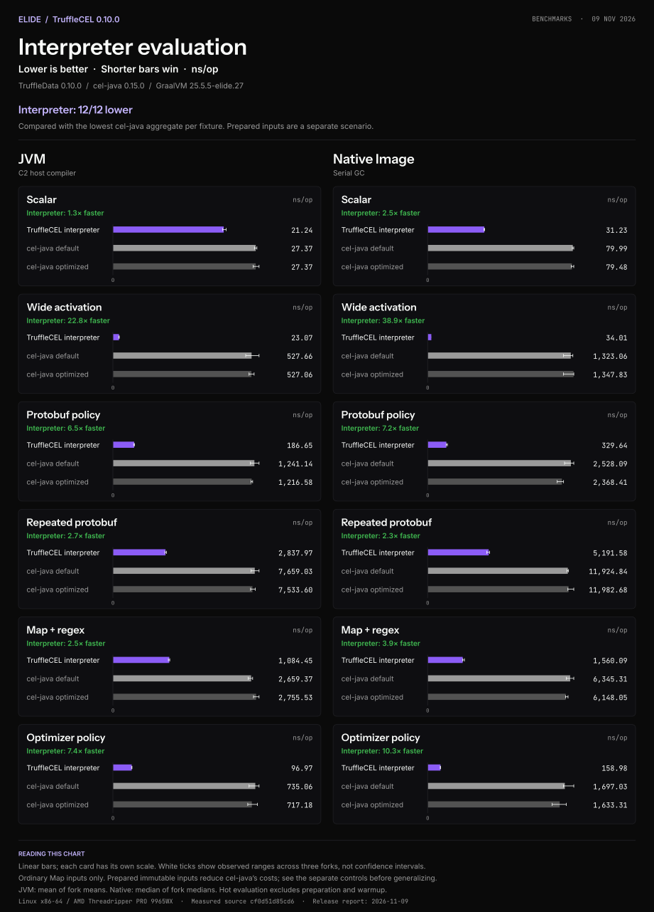
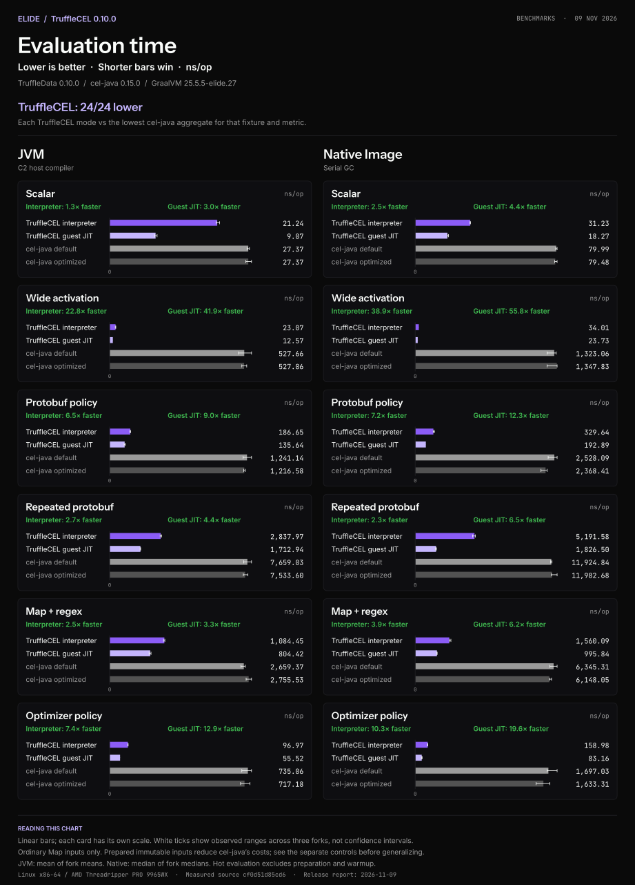
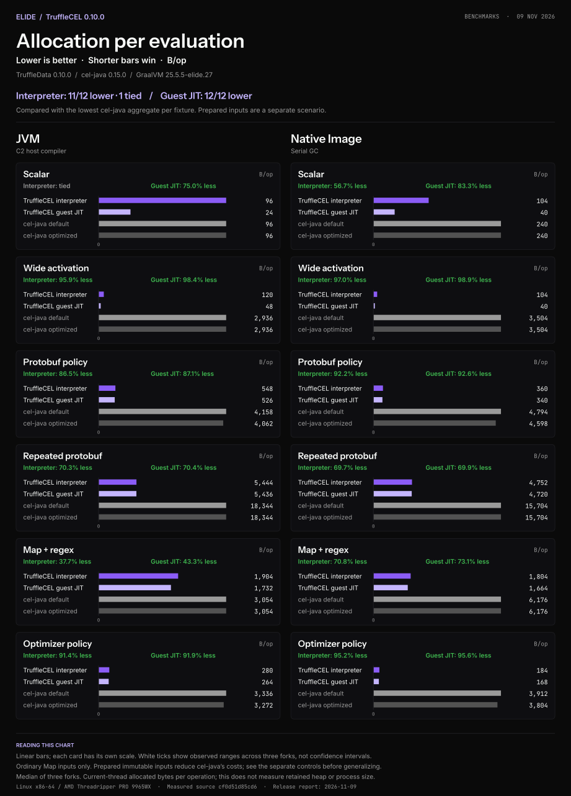
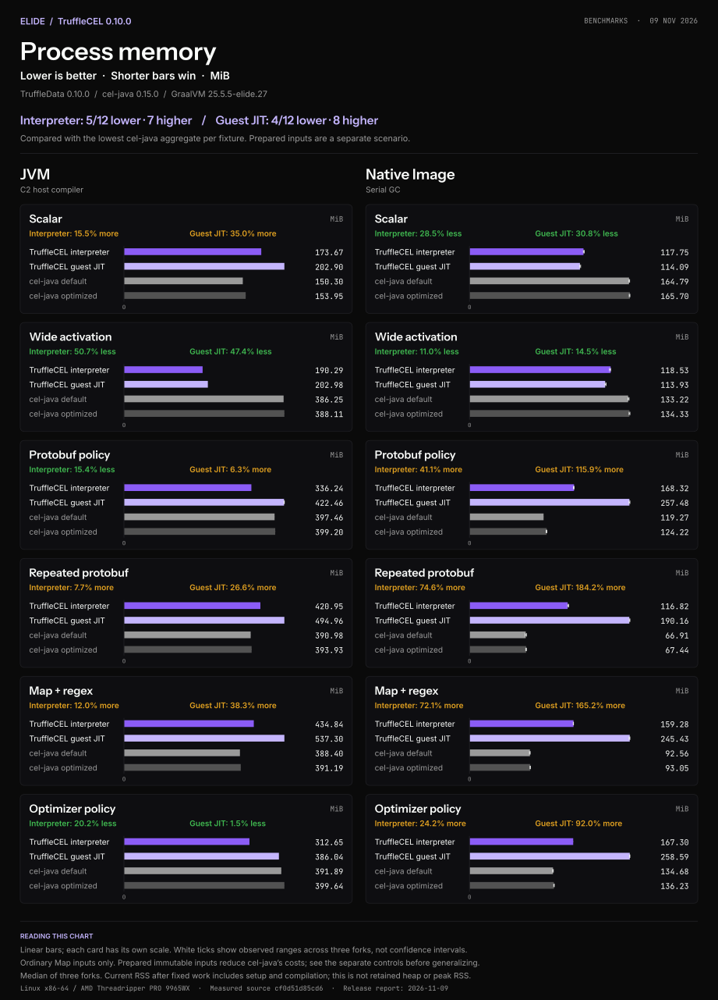
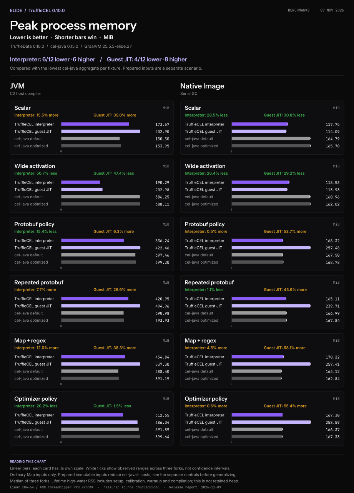
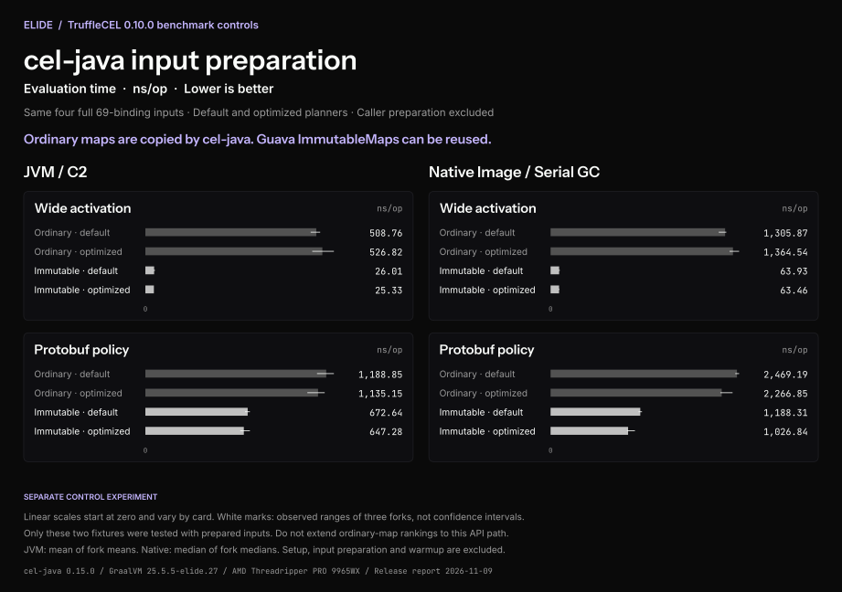
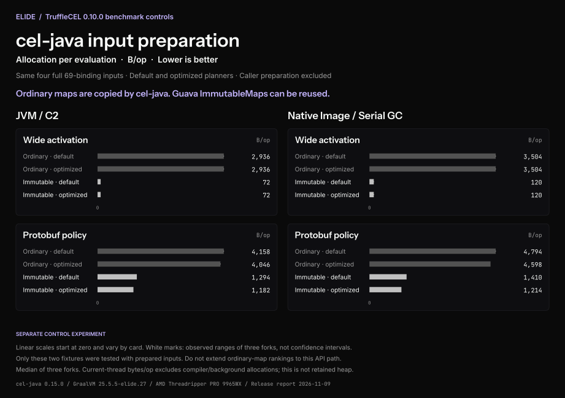

# TruffleCEL 0.10.0 benchmark charts

Shorter bars are better. Each card shows the same fixture on the same runtime,
with a linear scale starting at zero. Scales differ between cards. Every value
is printed beside its bar; the interpreter and guest-JIT comparisons each use
the lower cel-java default/optimized aggregate for that metric. Green text means
faster or less; amber means slower or more. The words carry the same information
without relying on color. White ticks show observed three-fork ranges, not
confidence intervals or significance tests.

Start with interpreter-to-interpreter execution. Guest JIT is a separate
preparation/throughput choice, so its counts are shown separately in the charts.
The [comparison guide](../../BENCHMARK_COMPARISON.md) maps the presentation to
upstream methodology feedback and identifies remaining evidence gaps.

These charts restyle the [November 9 release measurements](../../benchmarks/release-0.10.0-20261109/README.md).
They do not change or rerun the experiment. The original release charts, data,
checksums, and release assets remain preserved. The separate three-expression
CI suite is not pooled into these six-fixture charts.

| Metric | TruffleCEL lower | Tied | Higher | Downloads |
| --- | ---: | ---: | ---: | --- |
| Evaluation time | 24 | 0 | 0 | [SVG](evaluation-time.svg) · [PNG](evaluation-time.png) |
| Allocation per evaluation | 23 | 1 | 0 | [SVG](evaluation-allocation.svg) · [PNG](evaluation-allocation.png) |
| Current process RSS | 9 | 0 | 15 | [SVG](evaluation-rss.svg) · [PNG](evaluation-rss.png) |
| Lifetime peak process RSS | 10 | 0 | 14 | [SVG](evaluation-peak-rss.svg) · [PNG](evaluation-peak-rss.png) |

Counts compare both TruffleCEL modes independently across six fixtures and two
runtimes. This is not a universal engine ranking. In particular, these ordinary
Map inputs include cel-java's map-copying cost. The separate
[prepared-input controls](../../benchmarks/release-0.10.0-20261109/prepared-inputs.md)
reduce that cost substantially: JVM scalar-wide cel-java allocation is 72 B/op
with prepared immutable inputs, below TruffleCEL interpreter's 120 B/op.
Process RSS includes setup and compilation and is neither retained heap nor a
standalone deployment-footprint measurement. Hot timing excludes preparation and
warmup, so it does not describe first-evaluation latency.

The [complete tables](../../benchmarks/release-0.10.0-20261109/tables.md) provide a
text alternative with all values and ranges. The [renderer and brand provenance](../../../tools/bench/charts/README.md#archived-charts)
document the exact fonts, tokens, source data and reproduction command.

## Interpreter evaluation first

This comparison excludes TruffleCEL guest JIT. Both CEL engines interpret the
expression; the host JVM may still compile their Java implementation. Native
Image uses AOT host code. These are warm evaluations, not launch-to-first-result.

[SVG](interpreter-time.svg) · [PNG](interpreter-time.png)

## Hot evaluation with guest JIT

Guest compilation is forced before timing and its cost is excluded. See the
[startup and cumulative-cost limits](../../BENCHMARK_COMPARISON.md#startup-and-cumulative-cost)
before using this result for short-lived expressions.

## Allocation per evaluation

## Process memory

## Lifetime peak process memory

Peak RSS is the high-water resident memory for the entire process, including
setup, calibration, warmup and compilation. It is not a retained-heap measurement.
Do not add current and peak RSS; they are different observations of the same
process. Three interpreter peak-RSS comparisons have overlapping fork ranges.

## Prepared-input controls

These charts show the separate cel-java input-representation experiment: ordinary
captured maps versus caller-prepared Guava ImmutableMaps, both planner modes,
four full 69-binding inputs, two fixtures and three forks. They do not contribute
to the ordinary-map win counts. Preparation costs are excluded.

[Time SVG](prepared-time.svg) · [Time PNG](prepared-time.png) ·
[Allocation SVG](prepared-allocation.svg) · [Allocation PNG](prepared-allocation.png) ·
[Complete tables](../../benchmarks/release-0.10.0-20261109/prepared-inputs.md)

