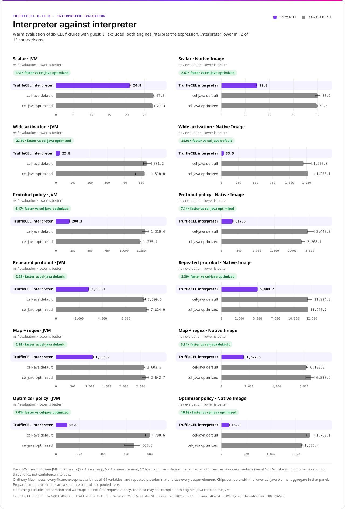
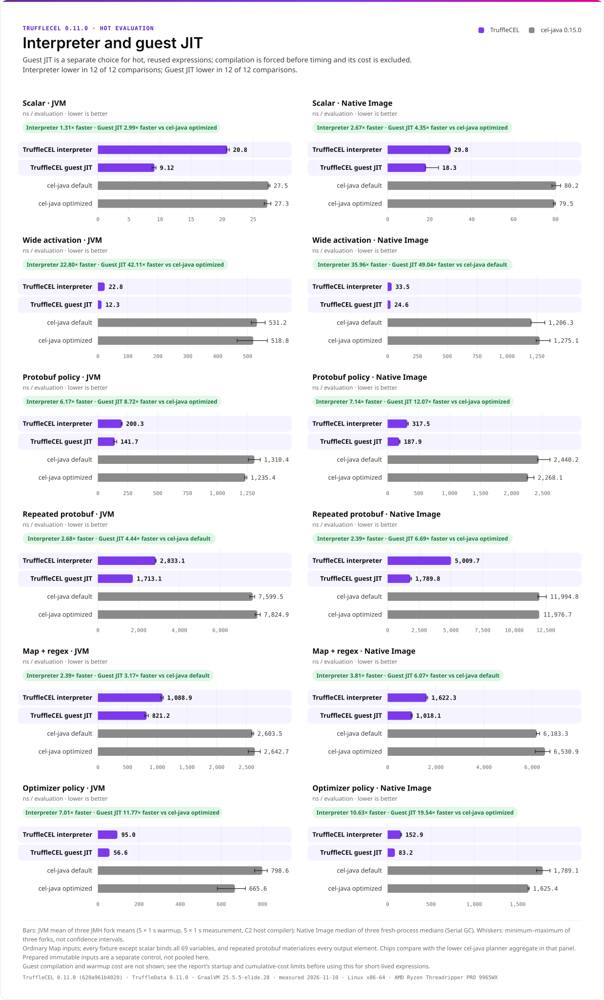
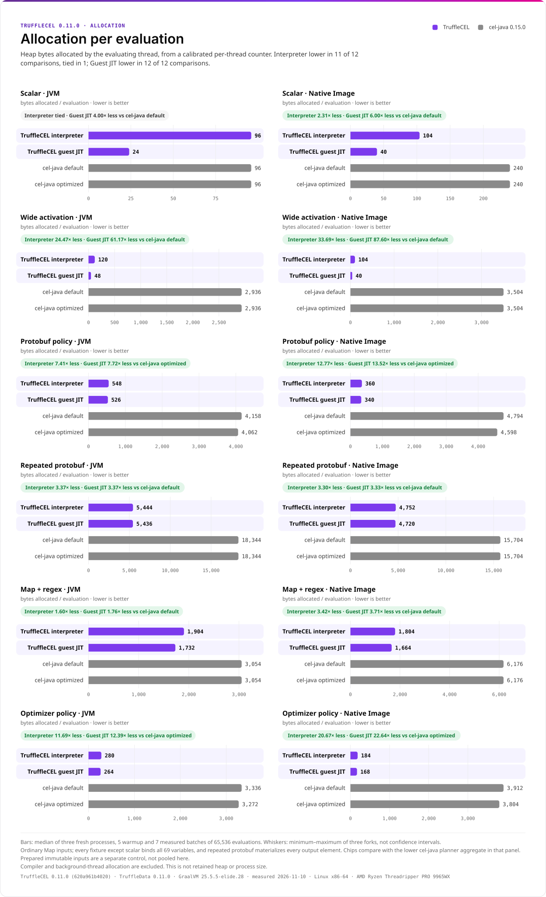
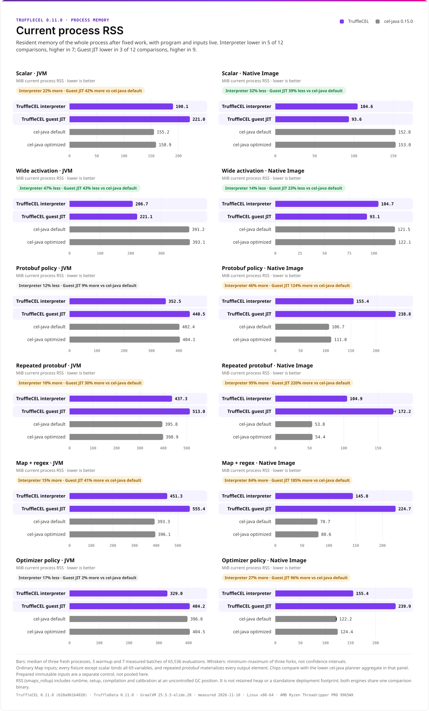
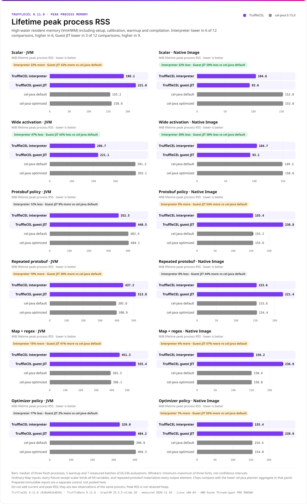
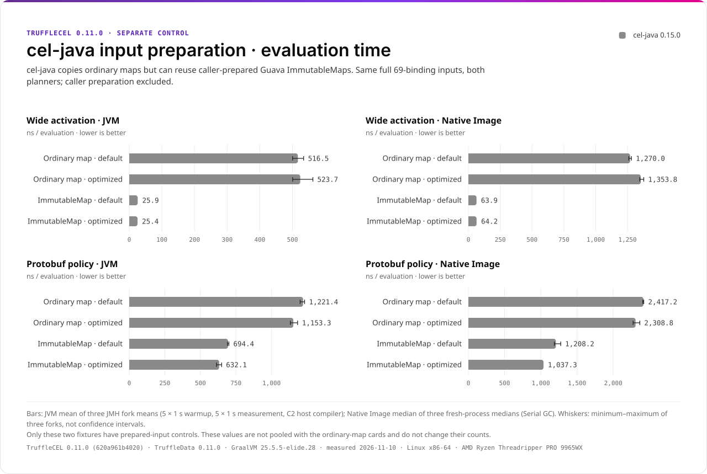
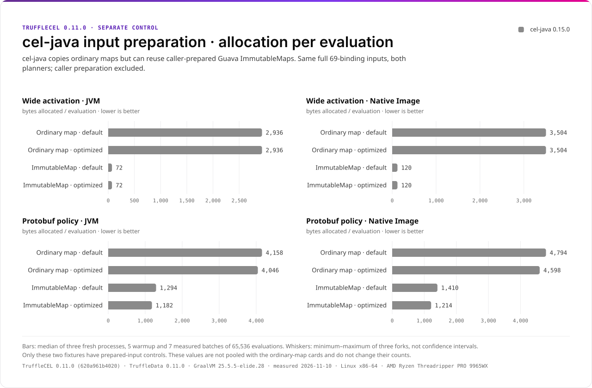

# TruffleCEL 0.11.0 benchmark cards

These cards present the [guarded November 10 release measurements](../../benchmarks/release-0.11.0-20261110/README.md)
of TruffleCEL 0.11.0, TruffleData 0.11.0, Elide GraalVM 25.5.5-elide.28 and
cel-java 0.15.0 on one Linux x86-64 AMD Ryzen Threadripper PRO 9965WX host. They
share TruffleData's benchmark design: purple bars are TruffleCEL, grey bars are
cel-java, and every value is printed beside its bar. Each panel has its own
zero-based linear scale. Whiskers show the minimum and maximum of three forks,
not confidence intervals. Each chip compares TruffleCEL with the lower cel-java
planner aggregate in that panel; its words carry the result without relying on color.

Start with interpreter-to-interpreter execution. Guest JIT is a separate choice for
hot, reused expressions, so its counts are kept separate. The
[comparison guide](../../BENCHMARK_COMPARISON.md) maps the presentation to
upstream methodology feedback and lists the remaining evidence gaps.

| Metric | Interpreter lower / tied / higher | Guest JIT lower / tied / higher |
| --- | ---: | ---: |
| Hot evaluation time | 12 / 0 / 0 | 12 / 0 / 0 |
| Current-thread allocation per evaluation | 11 / 1 / 0 | 12 / 0 / 0 |
| Current whole-process RSS | 5 / 0 / 7 | 3 / 0 / 9 |
| Lifetime peak whole-process RSS | 6 / 0 / 6 | 3 / 0 / 9 |

Counts cover six fixtures on JVM and Native Image with ordinary Map inputs. They
are descriptive, not significance tests or a universal ranking. Every plotted value
and range is in [cards.md](cards.md); [manifest.json](manifest.json) records source,
renderer, font and image hashes. The [0.10.0 charts](../benchmark-0.10.0-elide/README.md)
remain unchanged as historical presentations of the earlier release.

## Interpreter against interpreter

Both engines interpret the expression; the host JVM may still compile their Java
implementations, and Native Image uses ahead-of-time host code. These are warm
evaluations, not launch-to-first-result latency.

<picture>
  <source media="(prefers-color-scheme: dark)" srcset="interpreter-time-dark.svg">
  
</picture>

## Hot evaluation with guest JIT

Guest compilation is forced before timing, and its cost is excluded. See the
[startup and cumulative-cost limits](../../BENCHMARK_COMPARISON.md#startup-and-cumulative-cost)
before applying this result to short-lived expressions.

<picture>
  <source media="(prefers-color-scheme: dark)" srcset="evaluation-time-dark.svg">
  
</picture>

## Allocation per evaluation

<picture>
  <source media="(prefers-color-scheme: dark)" srcset="evaluation-allocation-dark.svg">
  
</picture>

## Current process memory

Current RSS covers the whole process after fixed work, including runtime, setup
and compilation. It is not retained heap or a standalone deployment footprint.
TruffleCEL is higher in most comparisons, especially guest JIT on Native Image.

<picture>
  <source media="(prefers-color-scheme: dark)" srcset="evaluation-rss-dark.svg">
  
</picture>

## Lifetime peak process memory

Peak RSS is the high-water mark including setup, calibration, warmup and
compilation. Do not add current and peak RSS; they observe the same process.

<picture>
  <source media="(prefers-color-scheme: dark)" srcset="evaluation-peak-rss-dark.svg">
  
</picture>

## Prepared-input controls

cel-java copies ordinary maps but can reuse caller-prepared Guava ImmutableMaps.
This separate experiment covers only scalar-wide and protobuf-policy, both
planners and both runtimes, with caller preparation excluded. JVM scalar-wide
cel-java allocation falls from 2,936 to 72 B/op, below the TruffleCEL interpreter's
120 B/op in the main suite. Do not extend ordinary-map counts to this input API.

<picture>
  <source media="(prefers-color-scheme: dark)" srcset="prepared-time-dark.svg">
  
</picture>

<picture>
  <source media="(prefers-color-scheme: dark)" srcset="prepared-allocation-dark.svg">
  
</picture>

## Regenerate

```sh
python3 -m venv /tmp/trufflecel-charts
/tmp/trufflecel-charts/bin/pip install -r tools/bench/charts/requirements.txt
/tmp/trufflecel-charts/bin/python tools/bench/charts/render_cards.py \
  --report docs/benchmarks/release-0.11.0-20261110 \
  --output docs/images/benchmark-0.11.0 --measured 2026-11-10
```

See the [renderer documentation](../../../tools/bench/charts/README.md) for the
validation rules, design provenance and font licensing.
