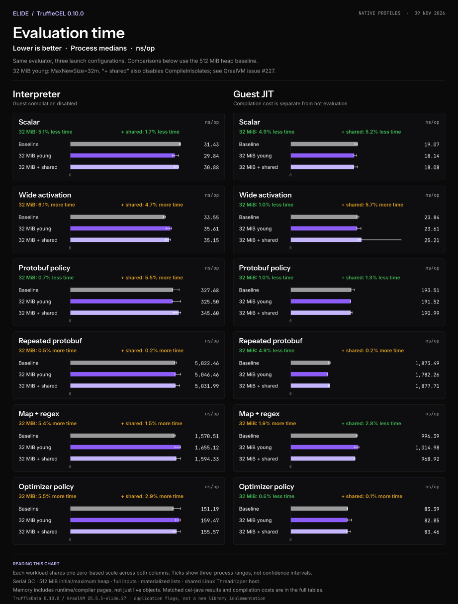
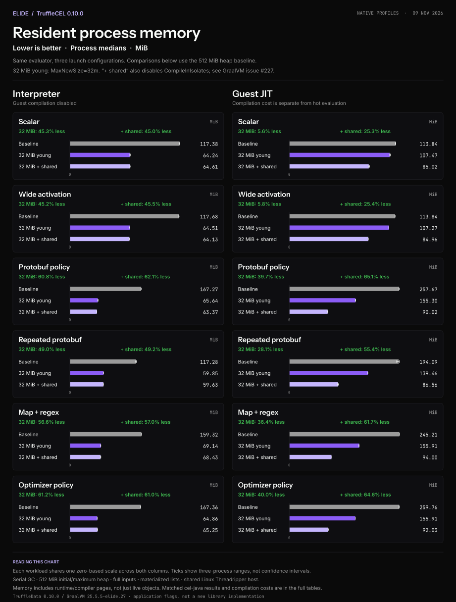
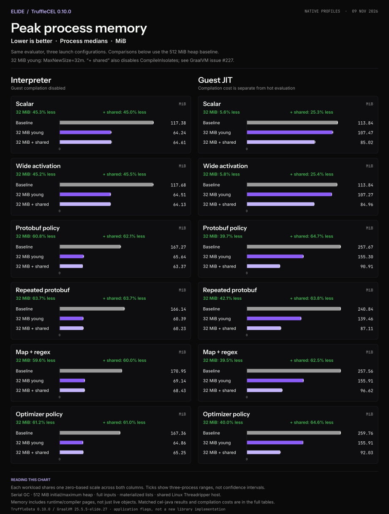

# Native launch profile charts

These charts compare three launch configurations of the same released TruffleCEL
0.10.0 evaluator, with TruffleData 0.10.0 and GraalVM 25.5.5-elide.27. They use
Elide's Instrument Sans, Inter and JetBrains Mono files and design tokens; see
[font provenance and reproduction](../../../tools/bench/charts/README.md).

All configurations use Serial GC with a 512 MiB initial/maximum heap. “32 MiB
young” adds `-XX:MaxNewSize=32m`; “+ shared” also adds `-XX:-CompileInIsolates`.
The latter reproduces [GraalVM #227](https://github.com/elide-dev/graal/issues/227).
These are opt-in application settings, not new library defaults.

Lower is better. Each workload uses one zero-based scale shared across the two
columns. Values are three-process medians; whiskers are observed process ranges,
not confidence intervals. All six fixtures are shown, with interpreter and guest
JIT separate. Compilation is excluded from hot evaluation and retained separately
in the [complete tables](../../benchmarks/native-profiles-20261109/young-generation/tables.md).
The tables are also the text alternative and include all matched cel-java controls,
allocation and proportional set size (PSS). Do not pool these measurements with
the release charts or earlier shared-compiler-only run.

## Evaluation time

[PNG](evaluation-time.png). With isolation retained, the young-generation cap
changes interpreter medians by −5.1% to +6.1% and guest-JIT medians by −4.9% to
+1.9%. Lower memory does not guarantee unchanged throughput. These hot-loop
results do not establish natural-JIT payback or application tail latency.

## Current resident memory

[PNG](current-rss.png). Materialized comprehension interpreter RSS falls from
117.28 to 59.85 MiB with the cap, versus 65.33 MiB for matched optimized cel-java.
Guest-JIT RSS falls from 194.09 to 139.46 MiB, or 86.56 MiB when shared compilation
is also enabled. The latter still exceeds matched cel-java's 65.46 MiB.

## Lifetime peak resident memory

[PNG](peak-rss.png). Comprehension interpreter peak RSS falls from 166.14 to
60.39 MiB with the cap. Guest-JIT peak RSS falls from 240.84 to 139.46 MiB,
or 87.11 MiB with shared compilation. Peak and endpoint RSS are different metrics;
neither measures live Java objects or standalone application image size.

Evaluating-thread allocation is unchanged across all three configurations in
every engine/workload cell. The memory reduction reflects resident capacity and
runtime overhead, not fewer allocated bytes per evaluation. Measurements use full
Map inputs and materialized lists on a shared Linux Threadripper host, without
exclusive CPU or thermal control. See the [qualification report](../../benchmarks/native-profiles-20261109/young-generation/README.md)
for raw records, source identities, method, tradeoffs and counter controls.

Regenerate with `tools/bench/charts/render_native_profiles.py` at commit `710e163`
in its pinned chart environment; see [archived charts](../../../tools/bench/charts/README.md#archived-charts).
SVG glyphs are outlined from the exact fonts; PNG uses the same files.
The renderer verifies all 72 cells against raw data and writes [SHA256SUMS](SHA256SUMS).
